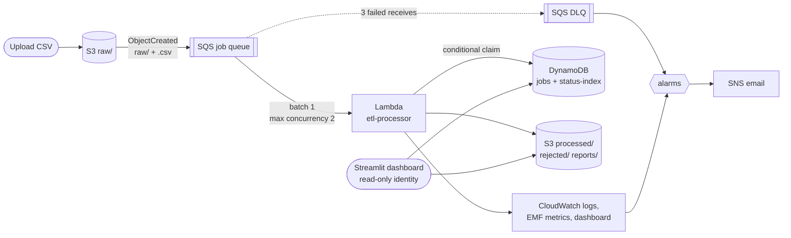

# Serverless ETL & Data Quality Platform on AWS

An event-driven ETL pipeline. A CSV dropped into S3 is queued in SQS, validated and cleaned by
Lambda against a JSON schema, written back to S3 as clean rows, rejected rows and a quality
report, tracked in DynamoDB, monitored with CloudWatch, and shown on a Streamlit dashboard. The
whole stack deploys and deletes with one command each (AWS SAM) and runs inside the AWS Free
plan.

**Python · S3 · SQS · Lambda · DynamoDB · CloudWatch · SNS · IAM · AWS SAM · Streamlit**
(V2: Glue Data Catalog · Athena · Parquet)

What this project demonstrates, live:

1. **Replaying the same upload creates no duplicates.** Conditional DynamoDB claims plus
   deterministic output keys ([ADR 001](docs/decisions/001-idempotency.md)).
2. **A poison file lands in the DLQ and shows up as a failed job**, an alarm fires, and after a
   fix a redrive reclaims the same job ([architecture: failure modes](docs/architecture.md#failure-modes)).
3. **The stack deploys and deletes with one command each.**

## Architecture



S3 notifies SQS, SQS triggers one Lambda, and that Lambda is the only thing that writes outputs
or job state. Every failure path ends in the dead-letter queue and a CloudWatch alarm. The full
request path, every resource with its reason, the IAM boundaries, all failure modes and the
scaling behaviour are in **[docs/architecture.md](docs/architecture.md)**.

| Layer | What | Key settings |
|---|---|---|
| Storage | S3 bucket `etl-pipeline-<account>-<region>` | versioned, SSE-S3, public access blocked, lifecycle expiry |
| Queueing | SQS queue + DLQ | 360 s visibility, redrive after 3 receives, 14-day DLQ |
| Compute | Lambda `etl-processor-dev` | Python 3.12, arm64, 512 MB, 60 s, stdlib + boto3 only |
| State | DynamoDB `etl-jobs-dev` | PK `job_id`, GSI `status-index`, provisioned 5/5 (free) |
| Observability | CloudWatch | 3 alarms → SNS, dashboard, 4 EMF metrics, saved Logs Insights queries |
| Access | IAM | explicit least-privilege Lambda role; read-only dashboard policy |
| Analytics (V2) | Glue + Athena + Parquet | partition projection, no crawler, 100 MB scan cap |

### Data layout

```
raw/sales/sales_2026.csv                                              input, never modified
processed/dataset=sales/ingest_date=2026-10-10/job_id=<id>/part-0000.csv
rejected/dataset=sales/job_id=<id>/rejected.csv                       original row + reasons
reports/dataset=sales/<id>.json                                       processing report
curated/dataset=sales/ingest_date=2026-10-10/job_id=<id>/part-0000.parquet   (V2)
```

Datasets are config, not code: `src/schemas/<dataset>.json` defines columns, types, rules,
the dedup key, derived fields and aggregates. `docs/demo/returns.json` is a second dataset
that runs through the same code unchanged.

## Repository layout

```
template.yaml            the whole AWS stack (SAM)        samconfig.toml   stack/region/profile
src/etl_processor/       Lambda: app (handler), jobs, storage, metrics  (AWS)
                         validator, transformer, reporter, pipeline, config  (pure, no AWS)
src/schemas/sales.json   dataset schema, packaged with the Lambda
dashboard/               Streamlit app: data.py, ui.py, views/
scripts/                 generate_sample, upload, replay_event, redrive_dlq.sh, run_benchmark,
                         make_dashboard_env, local_demo, teardown
tests/                   unit, integration (moto), dashboard (AppTest)
docs/                    architecture, dashboard guide, decisions/ (ADRs), evidence/
```

## Try it without AWS

```bash
python -m venv .venv
```
```bash
.venv\Scripts\pip install -r requirements-dev.txt
```
```bash
.venv\Scripts\python -m pytest
```
```bash
.venv\Scripts\python scripts/local_demo.py
```

The last command starts a local moto server standing in for S3/SQS/DynamoDB, runs the real
Lambda code over the sample files and opens the dashboard at http://localhost:8501. (On
macOS/Linux/WSL use `.venv/bin/...`, or `make venv test demo`. On Windows,
`.\make.ps1 venv`, `.\make.ps1 test` and `.\make.ps1 demo` do the same.)

## Deploy

### Prerequisites
- An AWS account on the Free plan, with MFA on the root user, the console region set to
  **Asia Pacific (Mumbai) ap-south-1**, and a **$5 monthly budget** with email alerts at 50%,
  80% and 100% (Billing → Budgets). Also turn on Free Tier usage alerts in Billing preferences.
- A deploy identity, profile **`etl-dev`**: IAM Identity Center with `AdministratorAccess`
  (`aws configure sso --profile etl-dev`), or an IAM user with access keys
  (`aws configure --profile etl-dev`). SAM creates IAM roles, so a narrower set blocks deploys.
  Never commit keys.
- Local tools: Python 3.12 (`py install 3.12` on Windows), AWS CLI v2, AWS SAM CLI, Git.
  Docker is not needed.

Check the identity:

```bash
aws sts get-caller-identity --profile etl-dev
```

### Build and deploy

```bash
sam validate --lint
```
```bash
sam build
```
```bash
sam deploy --parameter-overrides Stage=dev EnableAnalytics=false AlertEmail=you@example.com
```

`samconfig.toml` supplies the stack name (`serverless-etl-dev`), region, profile and
capabilities. `confirm_changeset = true` shows every change before it is applied. Confirm the
SNS subscription email so alarms reach you.

> `sam build` needs a local `python3.12`. The function has no third-party dependencies, so if
> you only have another Python version you can skip `sam build` and run `sam deploy` directly.
> SAM then zips `src/` as is.

### Dashboard identity

Create the read-only `etl-dashboard` IAM user, attach the `etl-dashboard-dev` policy the stack
created, then:

```bash
python scripts/make_dashboard_env.py
```
```bash
streamlit run dashboard/app.py
```

Step-by-step instructions: [docs/dashboard.md](docs/dashboard.md).

## Demo

Run against the deployed stack. Each scenario produces evidence for `docs/evidence/`.

| # | Scenario | Run | Expected | Evidence |
|---|---|---|---|---|
| 1 | Happy path | `python scripts/upload.py sample_data/clean_small.csv --wait` | job `SUCCEEDED`, 100/100 accepted | DynamoDB item, report JSON |
| 2 | Data quality | `python scripts/upload.py sample_data/dirty_small.csv --wait` | 950 accepted; 10 each of `missing_transaction_id`, `negative_quantity`, `invalid_transaction_date`, `invalid_unit_price`, `duplicate_id` (exactly what `dirty_small.expected.json` says) | Data quality page, `rejected.csv` |
| 3 | Duplicate delivery | `python scripts/replay_event.py raw/sales/dirty_small.csv --times 3` | 3 × `duplicate_delivery` logs; attempts, totals and S3 object count unchanged (the script prints IDEMPOTENT) | Logs Insights `recent-jobs`, script output |
| 4 | Poison file | `python scripts/upload.py sample_data/poison.csv` | job `FAILED` (`missing required columns: unit_price`) after 3 attempts; 1 DLQ message ~12–18 min later (3 receives, 6-min visibility); `DlqDepthAlarm` → ALARM + email | Alarm history, Operations page |
| 5 | Recovery | see below | the failed job is reclaimed and ends `SUCCEEDED` with attempts = 4; DLQ empty | Jobs page, DLQ depth |
| 6 | Burst load | `python scripts/run_benchmark.py --sizes 1000 --burst 20` | queue depth rises, concurrency holds at 2, 20/20 succeed, 0 throttles | `docs/evidence/benchmark.md`, CloudWatch dashboard |

**Scenario 5, recovery.** The fix is code, not the file, so the same job is reclaimed:

1. Upload a file for a dataset that has no schema yet:
   `python scripts/upload.py sample_data/returns_small.csv --dataset returns`.
   It fails with `UnknownDatasetError` and reaches the DLQ.
2. Ship the fix: copy `docs/demo/returns.json` to `src/schemas/returns.json`, then
   `sam build` and `sam deploy`.
3. Redrive: `bash scripts/redrive_dlq.sh` (Git Bash or WSL on Windows).
4. The job goes FAILED → SUCCEEDED with `attempts = 4`, and the second dataset appears on the
   Analytics page without any pipeline code change.

## V2: alerts and analytics

Alarm emails already work in V1 once you pass `AlertEmail` and confirm the subscription. V2 adds
Parquet output, a Glue catalog with partition projection, and Athena
([ADR 006](docs/decisions/006-parquet-and-athena.md)).

1. Open the **Glue** and **Athena** consoles once in `ap-south-1` to confirm your Free plan
   account can use them.
2. Deploy with analytics on:

   ```bash
   sam deploy --parameter-overrides Stage=dev EnableAnalytics=true AlertEmail=you@example.com
   ```
3. Process a file after enabling, so it gets Parquet output. Use a **new name**: identical
   bytes under the same key are the same job and are skipped as a duplicate.

   ```bash
   python scripts/upload.py sample_data/dirty_small.csv --name dirty_v2.csv --wait
   ```
4. Regenerate the dashboard config so the **Athena SQL** page lights up:

   ```bash
   python scripts/make_dashboard_env.py
   ```
5. Measure CSV against Parquet on identical rows (writes
   `docs/evidence/athena-comparison.md`):

   ```bash
   python scripts/compare_formats.py
   ```

Locally, the same 47,500 clean rows are **66% smaller** as snappy Parquet than as CSV
(876,620 vs 2,574,747 bytes), and a two-column query needs **89% fewer bytes** because Parquet
is columnar. The Athena bytes-scanned figures come from step 5.

## Results

Benchmark figures come only from `scripts/run_benchmark.py` against the deployed stack. It
writes [docs/evidence/benchmark.md](docs/evidence/benchmark.md) (rows/s, job duration, p95,
acceptance rate, burst behaviour). Copy the table here after your run:

| File | Job duration | Rows/s | Acceptance |
|---|---:|---:|---:|
| 1,000 rows | *run benchmark* | | |
| 10,000 rows | | | |
| 50,000 rows | | | |

Measured locally (not on AWS):

- **Tests:** 201 tests, 97% line coverage of the Lambda code (`pytest --cov`). They cover
  replay idempotency, crash-after-upload recovery, lease expiry, late-writer protection,
  poison files, version pinning, redrive recovery, Parquet output, every dashboard page, and
  the template's security rules as code (no wildcard IAM, private encrypted bucket, retry
  timing, free-tier limits).
- **Pure row pipeline:** 50,000 rows processed in 2.29 s on the development laptop, after a
  profiling pass cut it from 7.56 s ([ADR 005](docs/decisions/005-lambda-not-glue.md)).

## Design decisions

| ADR | Decision |
|---|---|
| [001](docs/decisions/001-idempotency.md) | Idempotency via a DynamoDB lease and deterministic output keys |
| [002](docs/decisions/002-observability.md) | EMF metrics, three alarms, one dashboard |
| [003](docs/decisions/003-sqs-between-s3-and-lambda.md) | SQS between S3 and Lambda (not direct invoke or EventBridge) |
| [004](docs/decisions/004-dynamodb-for-job-metadata.md) | DynamoDB, not RDS, for job metadata |
| [005](docs/decisions/005-lambda-not-glue.md) | Lambda, not Glue ETL jobs, at this data size |
| [006](docs/decisions/006-parquet-and-athena.md) | Parquet in `curated/`, Glue tables with partition projection, capped Athena workgroup (V2) |

## Cost

Designed to cost well under $1 of credits. Lambda, SQS, DynamoDB (provisioned 10/10 of the free
25/25), CloudWatch (4 custom metrics, 3 alarms, 1 dashboard) and SNS all stay inside their
always-free allowances at this volume. S3 storage for a few MB costs fractions of a cent, and
lifecycle rules expire reports, rejected rows and old versions. There are no NAT gateways, VPC
endpoints, EC2, RDS, Glue crawlers or provisioned concurrency. Keep test files under 5 MB.

## Cleanup

Run each step yourself; each one deletes resources.

1. Empty the bucket, including every object version (the stack cannot be deleted otherwise):

   ```bash
   python scripts/teardown.py
   ```
2. Detach the dashboard policy from the `etl-dashboard` user, delete its access keys, and
   delete the user (`teardown.py` prints the exact commands).
3. Delete the stack:

   ```bash
   sam delete
   ```
4. Check **Billing → Bills** for leftovers. Remove the `aws-sam-cli-managed-default` stack too
   if you no longer use SAM.
