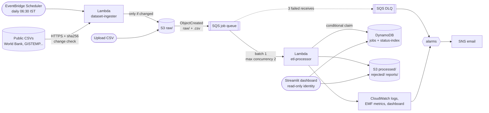

# Serverless ETL & Data Quality Platform on AWS

[](https://github.com/sandhyav6/aws-project/actions/workflows/ci.yml)


An event-driven AWS application that **automatically ingests public CSV datasets**, validates and
transforms their records, stores clean data and processing metadata, and generates analytics
that users explore through a dashboard.

- **Ingest.** A daily EventBridge Scheduler job runs a Lambda that downloads public datasets
  (World Bank population, global temperature anomalies) and lands them in S3 only when their
  content changed. You can also upload your own CSVs.
- **Validate and transform.** Every file in `raw/` flows S3 → SQS → Lambda, where a JSON schema
  drives type checks, ranges, de-duplication, normalisation and derived fields. Bad rows are kept
  with machine-readable reasons.
- **Store.** Clean rows (CSV, plus Parquet in V2), rejected rows and a JSON report go to S3. Job
  metadata (status, attempts, counts, timings, errors) goes to DynamoDB.
- **Explore.** A Streamlit dashboard shows population and climate trends, sales analytics, data
  quality, job history and queue health, and (V2) Athena SQL over Parquet.

It is safe under retries (idempotent), isolates poison files in a dead-letter queue, alarms
by email, deploys and deletes with one command each (AWS SAM), and runs inside the AWS Free
plan.

**Python · S3 · SQS · Lambda · EventBridge Scheduler · DynamoDB · CloudWatch · SNS · IAM ·
AWS SAM · Streamlit · GitHub Actions** (V2: Glue Data Catalog · Athena · Parquet)

What this project demonstrates, live:

1. **Public data arrives on its own, and only when it changed.** The ingester compares content
   hashes, so an unchanged day creates no job ([ADR 007](docs/decisions/007-automatic-public-dataset-ingestion.md)).
2. **Replaying the same upload creates no duplicates.** Conditional DynamoDB claims plus
   deterministic output keys ([ADR 001](docs/decisions/001-idempotency.md)).
3. **A poison file lands in the DLQ and shows up as a failed job**, an alarm fires, and after a
   fix a redrive reclaims the same job ([architecture: failure modes](docs/architecture.md#failure-modes)).
4. **The stack deploys and deletes with one command each**, and CI lints, tests and validates
   it on every push.

## Architecture



The ingester only lands files. S3 notifies SQS, SQS triggers one Lambda, and that Lambda is
the only thing that writes outputs or job state. Every failure path ends in the dead-letter queue and a CloudWatch alarm. The full
request path, every resource with its reason, the IAM boundaries, all failure modes and the
scaling behaviour are in **[docs/architecture.md](docs/architecture.md)**.

| Layer | What | Key settings |
|---|---|---|
| Ingestion | EventBridge Scheduler + Lambda `dataset-ingester-dev` | daily 06:30 Asia/Kolkata, HTTPS only, 5 MB cap, sha256 change detection, sources in `src/sources.json` |
| Storage | S3 bucket `etl-pipeline-<account>-<region>` | versioned, SSE-S3, public access blocked, lifecycle expiry |
| Queueing | SQS queue + DLQ | 360 s visibility, redrive after 3 receives, 14-day DLQ |
| Compute | Lambda `etl-processor-dev` | Python 3.12, arm64, 512 MB, 60 s, stdlib + boto3 only |
| State | DynamoDB `etl-jobs-dev` | PK `job_id`, GSI `status-index`, provisioned 5/5 (free) |
| Observability | CloudWatch | 4 alarms → SNS, dashboard, 4 EMF metrics, saved Logs Insights queries |
| Access | IAM | explicit least-privilege role per function; read-only dashboard policy |
| Delivery | GitHub Actions | ruff, pytest (coverage ≥ 90% enforced), cfn-lint, `sam validate`, `sam build`; no AWS credentials |
| Analytics (V2) | Glue + Athena + Parquet | partition projection, no crawler, 100 MB scan cap |

### Data layout

```
raw/world_population/world_population.csv                             public snapshot (versioned)
raw/sales/sales_2026.csv                                              input, never modified
processed/dataset=sales/ingest_date=2026-10-10/job_id=<id>/part-0000.csv
rejected/dataset=sales/job_id=<id>/rejected.csv                       original row + reasons
reports/dataset=sales/<id>.json                                       processing report
curated/dataset=sales/ingest_date=2026-10-10/job_id=<id>/part-0000.parquet   (V2)
```

### Datasets

Datasets are config, not code. `src/schemas/<dataset>.json` defines columns, types, ranges,
(composite) dedup keys, decimal scale, derived fields, `load_type` and aggregates
(sum/mean/min/max/count, daily/yearly/group, `where` and `exclude` filters).
`src/sources.json` says where public datasets come from.

| Dataset | Origin | Type | Rows | What you can explore |
|---|---|---|---:|---|
| `world_population` | World Bank SP.POP.TOTL via [datasets/population](https://github.com/datasets/population) (ODC-PDDL) | public snapshot, daily check | ~17.4k | world, India and China population by year; largest countries (49 World Bank regional aggregates excluded) |
| `global_temperature` | [datasets/global-temp](https://github.com/datasets/global-temp) (CC-BY-4.0) | public snapshot, daily check | ~3.9k | yearly mean anomaly for each record (GISTEMP, GCAG); warmest month |
| `sales` | synthetic generator with known bad rows | incremental uploads | any | daily sales, by category and region; exact data-quality checks |
| `returns` | synthetic, schema in `docs/demo/` | incremental | 50 | the recovery demo: a dataset added without code changes |

Both public files were run through the real pipeline before adoption: 100% accepted. The Mauna
Loa CO2 file was rejected as a source because its header has 6 columns but its rows have 7;
the validator would rightly reject every row as `malformed_row`.

## Repository layout

```
template.yaml            the whole AWS stack (SAM)        samconfig.toml   stack/region/profile
src/ingester/            Lambda: scheduled public-dataset ingestion with change detection
src/etl_processor/       Lambda: app (handler), jobs, storage, metrics  (AWS)
                         validator, transformer, reporter, pipeline, config  (pure, no AWS)
src/schemas/*.json       dataset schemas        src/sources.json   public sources
.github/workflows/ci.yml lint, test, validate on every push
dashboard/               Streamlit app: data.py, ui.py, views/
scripts/                 ingest_now, generate_sample, upload, replay_event, redrive_dlq.sh,
                         run_benchmark, compare_formats, make_dashboard_env, local_demo, teardown
tests/                   unit, integration (moto), dashboard (AppTest)
docs/                    architecture, dashboard guide, decisions/ (ADRs), evidence/
```

## Try it without AWS

```bash
python -m venv .venv
```
```bash
.venv\Scripts\pip install -r requirements-dev.txt
```
```bash
.venv\Scripts\python -m pytest
```
```bash
.venv\Scripts\python scripts/local_demo.py
```

The last command starts a local moto server standing in for S3/SQS/DynamoDB, runs the real
ingester against the live public sources (bundled fixtures if offline), runs the real Lambda
code over those and the sample files, and opens the dashboard at http://localhost:8501. (On
macOS/Linux/WSL use `.venv/bin/...`, or `make venv test demo`. On Windows,
`.\make.ps1 venv`, `.\make.ps1 test` and `.\make.ps1 demo` do the same.)

## Deploy

### Prerequisites
- An AWS account on the Free plan, with MFA on the root user, the console region set to
  **Asia Pacific (Mumbai) ap-south-1**, and a **$5 monthly budget** with email alerts at 50%,
  80% and 100% (Billing → Budgets). Also turn on Free Tier usage alerts in Billing preferences.
- A deploy identity, profile **`etl-dev`**: IAM Identity Center with `AdministratorAccess`
  (`aws configure sso --profile etl-dev`), or an IAM user with access keys
  (`aws configure --profile etl-dev`). SAM creates IAM roles, so a narrower set blocks deploys.
  Never commit keys.
- Local tools: Python 3.12 (`py install 3.12` on Windows), AWS CLI v2, AWS SAM CLI, Git.
  Docker is not needed.

Check the identity:

```bash
aws sts get-caller-identity --profile etl-dev
```

### Build and deploy

```bash
sam validate --lint
```
```bash
sam build
```
```bash
sam deploy --parameter-overrides Stage=dev EnableAnalytics=false AlertEmail=you@example.com
```

`samconfig.toml` supplies the stack name (`serverless-etl-dev`), region, profile and
capabilities. `confirm_changeset = true` shows every change before it is applied. Confirm the
SNS subscription email so alarms reach you.

The first public-dataset fetch happens at the next 06:30 IST. To fetch immediately:

```bash
python scripts/ingest_now.py
```

It prints `uploaded` for each dataset. Running it again prints `unchanged`, and no new jobs
appear.

> `sam build` needs a local `python3.12`. The functions have no third-party dependencies, so if
> you only have another Python version you can skip `sam build` and run `sam deploy` directly.
> SAM then zips `src/` as is.

### Dashboard identity

Create the read-only `etl-dashboard` IAM user, attach the `etl-dashboard-dev` policy the stack
created, then:

```bash
python scripts/make_dashboard_env.py
```
```bash
streamlit run dashboard/app.py
```

Step-by-step instructions: [docs/dashboard.md](docs/dashboard.md).

## Demo

Run against the deployed stack. Each scenario produces evidence for `docs/evidence/`.

| # | Scenario | Run | Expected | Evidence |
|---|---|---|---|---|
| 0 | Automatic ingestion | `python scripts/ingest_now.py` (or wait for 06:30 IST), then run it again | first run: 2 × `uploaded`, two public-dataset jobs SUCCEEDED (~17.4k and ~3.9k rows, 100% accepted); second run: 2 × `unchanged`, no new jobs | Sources page, Analytics page, `dataset_ingest` logs |
| 1 | Happy path | `python scripts/upload.py sample_data/clean_small.csv --wait` | job `SUCCEEDED`, 100/100 accepted | DynamoDB item, report JSON |
| 2 | Data quality | `python scripts/upload.py sample_data/dirty_small.csv --wait` | 950 accepted; 10 each of `missing_transaction_id`, `negative_quantity`, `invalid_transaction_date`, `invalid_unit_price`, `duplicate_id` (exactly what `dirty_small.expected.json` says) | Data quality page, `rejected.csv` |
| 3 | Duplicate delivery | `python scripts/replay_event.py raw/sales/dirty_small.csv --times 3` | 3 × `duplicate_delivery` logs; attempts, totals and S3 object count unchanged (the script prints IDEMPOTENT) | Logs Insights `recent-jobs`, script output |
| 4 | Poison file | `python scripts/upload.py sample_data/poison.csv` | job `FAILED` (`missing required columns: unit_price`) after 3 attempts; 1 DLQ message ~12–18 min later (3 receives, 6-min visibility); `DlqDepthAlarm` → ALARM + email | Alarm history, Operations page |
| 5 | Recovery | see below | the failed job is reclaimed and ends `SUCCEEDED` with attempts = 4; DLQ empty | Jobs page, DLQ depth |
| 6 | Burst load | `python scripts/run_benchmark.py --sizes 1000 --burst 20` | queue depth rises, concurrency holds at 2, 20/20 succeed, 0 throttles | `docs/evidence/benchmark.md`, CloudWatch dashboard |

**Scenario 5, recovery.** The fix is code, not the file, so the same job is reclaimed:

1. Upload a file for a dataset that has no schema yet:
   `python scripts/upload.py sample_data/returns_small.csv --dataset returns`.
   It fails with `UnknownDatasetError` and reaches the DLQ.
2. Ship the fix: copy `docs/demo/returns.json` to `src/schemas/returns.json`, then
   `sam build` and `sam deploy`.
3. Redrive: `bash scripts/redrive_dlq.sh` (Git Bash or WSL on Windows).
4. The job goes FAILED → SUCCEEDED with `attempts = 4`, and the second dataset appears on the
   Analytics page without any pipeline code change.

## V2: alerts and analytics

Alarm emails already work in V1 once you pass `AlertEmail` and confirm the subscription. V2 adds
Parquet output, a Glue catalog with partition projection, and Athena
([ADR 006](docs/decisions/006-parquet-and-athena.md)).

1. Open the **Glue** and **Athena** consoles once in `ap-south-1` to confirm your Free plan
   account can use them.
2. Deploy with analytics on:

   ```bash
   sam deploy --parameter-overrides Stage=dev EnableAnalytics=true AlertEmail=you@example.com
   ```
3. Process a file after enabling, so it gets Parquet output. Use a **new name**: identical
   bytes under the same key are the same job and are skipped as a duplicate.

   ```bash
   python scripts/upload.py sample_data/dirty_small.csv --name dirty_v2.csv --wait
   ```
4. Regenerate the dashboard config so the **Athena SQL** page lights up:

   ```bash
   python scripts/make_dashboard_env.py
   ```
5. Measure CSV against Parquet on identical rows (writes
   `docs/evidence/athena-comparison.md`):

   ```bash
   python scripts/compare_formats.py
   ```

Locally, the same 47,500 clean rows are **66% smaller** as snappy Parquet than as CSV
(876,620 vs 2,574,747 bytes), and a two-column query needs **89% fewer bytes** because Parquet
is columnar. The Athena bytes-scanned figures come from step 5.

## Results

Benchmark figures come only from `scripts/run_benchmark.py` against the deployed stack. It
writes [docs/evidence/benchmark.md](docs/evidence/benchmark.md) (rows/s, job duration, p95,
acceptance rate, burst behaviour). Copy the table here after your run:

| File | Job duration | Rows/s | Acceptance |
|---|---:|---:|---:|
| 1,000 rows | *run benchmark* | | |
| 10,000 rows | | | |
| 50,000 rows | | | |

Measured locally (not on AWS):

- **Tests:** 248 tests, 98% line coverage of both Lambdas (`pytest --cov`; CI fails below 90%).
  They pass on Python 3.12 (the Lambda runtime) and 3.14. They cover public-dataset ingestion
  and change detection, replay idempotency, crash-after-upload recovery, lease expiry,
  late-writer protection, poison files, version pinning, redrive recovery, Parquet output,
  every dashboard page, and the template's security rules as code (no wildcard IAM, private
  encrypted bucket, retry timing, free-tier limits).
- **Live public data:** world_population (17,394 rows) and global_temperature (3,871 rows) are
  100% accepted by the real pipeline, each processed in under a second locally.
- **Packaging:** `sam build` with Python 3.12 produces both functions with their schemas and
  `sources.json`; CI repeats this on every push.
- **Pure row pipeline:** 50,000 rows processed in 2.29 s on the development laptop, after a
  profiling pass cut it from 7.56 s ([ADR 005](docs/decisions/005-lambda-not-glue.md)).

## Design decisions

| ADR | Decision |
|---|---|
| [001](docs/decisions/001-idempotency.md) | Idempotency via a DynamoDB lease and deterministic output keys |
| [002](docs/decisions/002-observability.md) | EMF metrics (no dimensions, 4 total), four alarms, one dashboard |
| [003](docs/decisions/003-sqs-between-s3-and-lambda.md) | SQS between S3 and Lambda (not direct invoke or EventBridge) |
| [004](docs/decisions/004-dynamodb-for-job-metadata.md) | DynamoDB, not RDS, for job metadata |
| [005](docs/decisions/005-lambda-not-glue.md) | Lambda, not Glue ETL jobs, at this data size |
| [006](docs/decisions/006-parquet-and-athena.md) | Parquet in `curated/`, Glue tables with partition projection, capped Athena workgroup (V2) |
| [007](docs/decisions/007-automatic-public-dataset-ingestion.md) | Scheduled public-dataset ingestion with sha256 change detection; snapshot-aware schemas |

## Cost

Designed to cost well under $1 of credits. Lambda, SQS, DynamoDB (provisioned 10/10 of the free
25/25), CloudWatch (4 of 10 custom metrics, 4 of 10 alarms, 1 of 3 dashboards), EventBridge
Scheduler (~30 of 14M invocations a month) and SNS all stay inside their always-free allowances
at this volume. Downloading the public datasets is inbound transfer, which is free. S3 storage for a few MB costs fractions of a cent, and
lifecycle rules expire reports, rejected rows and old versions. There are no NAT gateways, VPC
endpoints, EC2, RDS, Glue crawlers or provisioned concurrency. Keep test files under 5 MB.

## Cleanup

Run each step yourself; each one deletes resources.

1. Empty the bucket, including every object version (the stack cannot be deleted otherwise):

   ```bash
   python scripts/teardown.py
   ```
2. Detach the dashboard policy from the `etl-dashboard` user, delete its access keys, and
   delete the user (`teardown.py` prints the exact commands).
3. Delete the stack:

   ```bash
   sam delete
   ```
4. Check **Billing → Bills** for leftovers. Remove the `aws-sam-cli-managed-default` stack too
   if you no longer use SAM.
