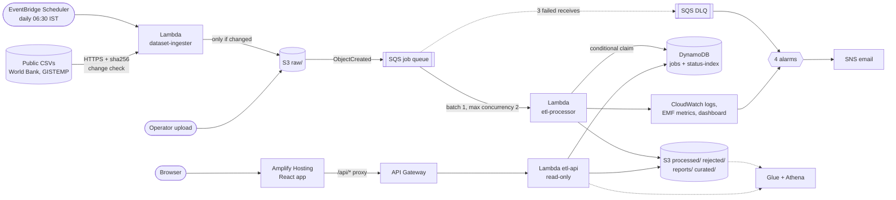

# Serverless ETL & Data Quality Platform on AWS

[](https://github.com/sandhyav6/aws-project/actions/workflows/ci.yml)


**Live site: https://main.d18xoo8gkaam5b.amplifyapp.com**

An event-driven AWS application that **automatically ingests public CSV datasets**, validates and
transforms their records, stores clean data and processing metadata, and generates analytics
that users explore through a **React dashboard**.

- **Ingest.** EventBridge Scheduler runs a Lambda every morning that downloads public datasets
  (World Bank population, global temperature anomalies) and lands them in S3 only when their
  content changed.
- **Validate and transform.** Every file in `raw/` flows S3 → SQS → Lambda, where a JSON schema
  drives type checks, ranges, de-duplication, normalisation and derived fields. Bad rows are kept
  with machine-readable reasons.
- **Store.** Clean rows (CSV + Parquet), rejected rows and a JSON report go to S3. Job metadata
  (status, attempts, counts, timings, errors) goes to DynamoDB.
- **Explore.** A React + Vite + TypeScript + Tailwind site on AWS Amplify, served by a read-only
  API (API Gateway + Lambda): population and climate trends, sales analytics, data quality, job
  history, queue health and Athena SQL.

It is safe under retries (idempotent), isolates poison files in a dead-letter queue, alarms by
email, deploys and deletes with one command each (AWS SAM), and runs inside the AWS Free plan.

**Python · TypeScript · React · Tailwind · S3 · SQS · Lambda · EventBridge Scheduler ·
DynamoDB · API Gateway · Amplify · CloudWatch · SNS · IAM · Glue · Athena · AWS SAM · GitHub
Actions**

What this project demonstrates, live:

1. **Public data arrives on its own, and only when it changed.** Content hashes mean an
   unchanged day creates no job ([ADR 007](docs/decisions/007-automatic-public-dataset-ingestion.md)).
2. **Replaying the same upload creates no duplicates.** Conditional DynamoDB claims plus
   deterministic output keys ([ADR 001](docs/decisions/001-idempotency.md)).
3. **A poison file lands in the DLQ and shows up as a failed job**, an alarm emails the
   operator, and after a fix a redrive reclaims the same job.
4. **A public website that can only read.** No write route exists, and the API's IAM role
   can't write ([ADR 008](docs/decisions/008-react-frontend-on-amplify.md)).
5. **One command deploys and deletes it all**, and CI lints, tests, type-checks and builds
   everything on every push.

## Architecture



The full request path, every resource with its reason, the IAM boundaries, the failure modes,
the web layer and the scaling behaviour are in **[docs/architecture.md](docs/architecture.md)**.

| Layer | What | Key settings |
|---|---|---|
| Ingestion | EventBridge Scheduler + Lambda `dataset-ingester-dev` | daily 06:30 Asia/Kolkata, HTTPS only, 5 MB cap, sha256 change detection |
| Storage | S3 `etl-pipeline-<account>-<region>` | versioned, SSE-S3, public access blocked, lifecycle expiry |
| Queueing | SQS queue + DLQ | 360 s visibility, redrive after 3 receives, 14-day DLQ |
| Processing | Lambda `etl-processor-dev` | Python 3.12, arm64, 512 MB, 60 s, stdlib + boto3 only |
| State | DynamoDB `etl-jobs-dev` | PK `job_id`, GSI `status-index`, provisioned 5/5 (free) |
| Web | Amplify Hosting + API Gateway HTTP API + Lambda `etl-api-dev` | React SPA, same-origin `/api/*`, GET only, 10 req/s throttle |
| Observability | CloudWatch + SNS | 4 alarms → email, dashboard, 4 EMF metrics, saved Logs Insights queries |
| Access | IAM | one least-privilege role per Lambda; public API role is read-only |
| Analytics (V2) | Glue + Athena + Parquet | partition projection, no crawler, 100 MB scan cap |
| Delivery | GitHub Actions | ruff, pytest (≥ 90% coverage), oxlint, tsc, vitest, vite build, cfn-lint, `sam validate`, `sam build` |

## Repository layout

```
frontend/                     React + Vite + TypeScript + Tailwind CSS (the website)
  src/pages/                  Overview, Analytics, Sources, Jobs, Job detail, Data quality,
                              Operations, Athena SQL, How it works
  src/components/ src/lib/    layout, cards, charts, typed API client, formatters
backend/                      everything that runs on AWS
  template.yaml               the whole stack (AWS SAM)        samconfig.toml  stack/region/profile
  src/ingester/               Lambda: scheduled public-dataset ingestion
  src/etl_processor/          Lambda: validate → transform → dedup → report (pure modules + AWS glue)
  src/api/                    Lambda: read-only JSON API for the website
  src/schemas/*.json          dataset rule books           src/sources.json  public sources
  tests/                      unit, integration (moto), api, template policy-as-code
  scripts/                    ingest_now, upload, replay_event, redrive_dlq.sh, run_benchmark,
                              compare_formats, deploy_frontend, local_demo, teardown
  sample_data/ demo/          synthetic files with known errors; the recovery-demo schema
docs/                         architecture, frontend guide, AWS step-by-step, ADRs, evidence
.github/workflows/ci.yml      CI for both halves
```

## Datasets

Datasets are config, not code. Each `backend/src/schemas/<dataset>.json` defines columns,
types, ranges, (composite) dedup keys, decimal scale, derived fields, `load_type` and
aggregates.

| Dataset | Origin | Type | Rows | What you can explore |
|---|---|---|---:|---|
| `world_population` | World Bank SP.POP.TOTL via [datasets/population](https://github.com/datasets/population) (ODC-PDDL) | public snapshot, daily check | 17,394 | world, India and China population by year; largest countries (49 World Bank aggregates excluded) |
| `global_temperature` | [datasets/global-temp](https://github.com/datasets/global-temp) (CC-BY-4.0) | public snapshot, daily check | 3,871 | yearly mean anomaly per record (GISTEMP, GCAG); warmest month |
| `sales` | synthetic generator with known bad rows | incremental uploads | any | daily sales, by category and region; exact data-quality checks |
| `returns` | synthetic | incremental | 50 | the recovery demo: a dataset added with no code change |

## Run it locally (no AWS account needed)

One-time setup, from the repo root:

```bash
python -m venv .venv
```
```bash
.venv\Scripts\pip install -r backend\requirements-dev.txt
```
```bash
cd frontend
```
```bash
npm ci
```

Then two terminals. First, a local fake AWS plus the real Lambda code, serving the API on port 8000:

```bash
cd backend
```
```bash
..\.venv\Scripts\python scripts\local_demo.py
```

Second, the website on http://localhost:5173:

```bash
cd frontend
```
```bash
npm run dev
```

Run the tests: `..\.venv\Scripts\python -m pytest` in `backend/`, and `npm test` in
`frontend/`. On Windows, `.\make.ps1 test` runs both; on Linux/macOS use `make test`.

## Deploy to AWS

Prerequisites (one time), with full click-by-click steps in
[docs/AWS_STEP_BY_STEP.md](docs/AWS_STEP_BY_STEP.md):
- An AWS account (Free plan), MFA on root, region **ap-south-1**, a $5 budget.
- An IAM user with CLI profile **`etl-dev`**.
- AWS CLI v2, AWS SAM CLI, Python 3.12 and Node 20+.

1. Deploy the stack (pipeline, API and Amplify app). Run from `backend/`:

   ```bash
   sam build
   ```
   ```bash
   sam deploy --parameter-overrides Stage=dev EnableAnalytics=true AlertEmail=sandhya.avm@gmail.com
   ```
   Confirm the SNS subscription email.
2. Publish the website. It builds React, uploads it to Amplify and prints the URL:

   ```bash
   ..\.venv\Scripts\python scripts\deploy_frontend.py
   ```
3. Fetch the public datasets now, instead of waiting for 06:30 IST:

   ```bash
   ..\.venv\Scripts\python scripts\ingest_now.py
   ```

## Demo

Run these from `backend/` against the deployed stack. Results appear on the website.

| # | Scenario | Run | Expected |
|---|---|---|---|
| 0 | Automatic ingestion | `python scripts/ingest_now.py`, twice | 1st: 2 × `uploaded`, two jobs SUCCEEDED (100% accepted). 2nd: 2 × `unchanged`, no new jobs |
| 1 | Happy path | `python scripts/upload.py sample_data/clean_small.csv --wait` | SUCCEEDED, 100/100 accepted |
| 2 | Data quality | `python scripts/upload.py sample_data/dirty_small.csv --wait` | 950 accepted; 10 each of 5 reason codes, exactly as in `dirty_small.expected.json` |
| 3 | Duplicate delivery | `python scripts/replay_event.py raw/sales/dirty_small.csv --times 3` | `IDEMPOTENT: nothing changed` |
| 4 | Poison file | `python scripts/upload.py sample_data/poison.csv` | FAILED after 3 tries; DLQ message ~12–18 min later; alarm email |
| 5 | Recovery | upload a file for a dataset with no schema → deploy its schema → `bash scripts/redrive_dlq.sh` | same job FAILED → SUCCEEDED, attempts = 4 |
| 6 | Burst load | `python scripts/run_benchmark.py --sizes 1000 --burst 20` | 20/20 succeed, concurrency holds at 2, 0 throttles |

## Results

**Measured on the deployed stack** (ap-south-1, Lambda arm64; details in
[benchmark.md](docs/evidence/benchmark.md), [demo-results.md](docs/evidence/demo-results.md)
and [athena-comparison.md](docs/evidence/athena-comparison.md)):

| File | Job duration | Rows/s | Acceptance | Upload → SUCCEEDED |
|---|---:|---:|---:|---:|
| 1,000 rows | 189 ms | 5,291 | 95.00% | 1.1 s |
| 10,000 rows | 823 ms | 12,151 | 95.00% | 2.1 s |
| 50,000 rows | 3,816 ms | 13,103 | 95.00% | 5.2 s |
| world_population (public) | 1,013 ms | 17,170 | 100% | — |
| global_temperature (public) | 311 ms | 12,447 | 100% | — |

- p95 job duration **770 ms**.
- **Burst of 20 files:** 20/20 succeeded, peak concurrency **2**, **0 throttles**, drained in 29.6 s.
- **Idempotency:** 3 replays changed nothing (attempts 1, 950 rows, 12 objects).
- **Recovery:** FAILED ×3 → DLQ → schema deployed → redrive → SUCCEEDED, attempts = 4.
- **Parquet vs CSV in Athena:** **85.8–87.6% fewer bytes scanned** on identical rows.
- **Tests:** **233** in total, all passing.
  - 214 backend tests (pytest, 97% coverage, on Python 3.12 and 3.14): ingestion, idempotency,
    crash recovery, poison files, redrive, Parquet, every API endpoint, and the template's
    security rules as code.
  - 19 frontend tests (Vitest + Testing Library).

## Design decisions

| ADR | Decision |
|---|---|
| [001](docs/decisions/001-idempotency.md) | Idempotency via a DynamoDB lease and deterministic output keys |
| [002](docs/decisions/002-observability.md) | EMF metrics (no dimensions, 4 total), four alarms, one dashboard |
| [003](docs/decisions/003-sqs-between-s3-and-lambda.md) | SQS between S3 and Lambda (not direct invoke or EventBridge) |
| [004](docs/decisions/004-dynamodb-for-job-metadata.md) | DynamoDB, not RDS, for job metadata |
| [005](docs/decisions/005-lambda-not-glue.md) | Lambda, not Glue ETL jobs, at this data size |
| [006](docs/decisions/006-parquet-and-athena.md) | Parquet in `curated/`, Glue tables with partition projection, capped Athena workgroup |
| [007](docs/decisions/007-automatic-public-dataset-ingestion.md) | Scheduled public-dataset ingestion with sha256 change detection; snapshot-aware schemas |
| [008](docs/decisions/008-react-frontend-on-amplify.md) | React SPA on Amplify Hosting with a same-origin, read-only Lambda API (CloudFront blocked pending account verification) |

## Cost

Designed to cost well under $1 of credits. Lambda, SQS, DynamoDB (10/10 of the free 25/25
capacity), CloudWatch (4 of 10 custom metrics, 4 of 10 alarms), EventBridge Scheduler, SNS,
API Gateway and Amplify Hosting stay within their free allowances at this volume. S3 and
Athena cost fractions of a cent. There are no servers, NAT gateways, VPC endpoints, RDS or Glue
crawlers.

## Cleanup

1. Empty the bucket, including every object version. It asks you to type `DELETE`. Run from
   `backend/`:

   ```bash
   ..\.venv\Scripts\python scripts\teardown.py
   ```
2. Delete the stack (pipeline, API, Amplify site and alarms):

   ```bash
   sam delete
   ```
3. Check **Billing → Bills**, and delete the `aws-sam-cli-managed-default` stack if you no
   longer use SAM.
