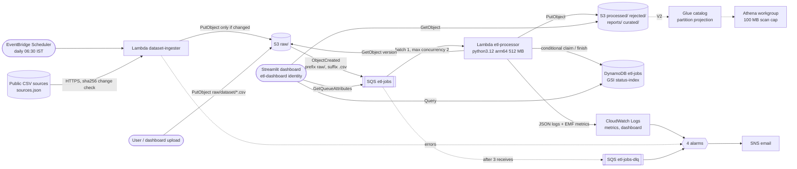

# Architecture

An event-driven application that **automatically ingests public CSV datasets**, validates and
transforms their records, stores clean data and processing metadata, and generates analytics
that users explore on a dashboard. A scheduled ingester lands public CSVs in
`s3://<bucket>/raw/<dataset>/` (uploads land there too). Every file there is queued, validated
against a JSON schema, cleaned, de-duplicated, reported on and tracked, with safe retries, a
dead-letter queue and alarms. Everything is one AWS SAM template in `ap-south-1`.

## Ingestion: how public data arrives

1. **Schedule.** EventBridge Scheduler invokes `dataset-ingester` daily at 06:30 IST. You can
   also run it on demand with `scripts/ingest_now.py` or the dashboard's **Fetch now**.
2. **Fetch.** For each source in `src/sources.json` the ingester downloads the CSV over HTTPS,
   capped at 5 MB (refused, not truncated).
3. **Compare.** It hashes the bytes and reads the `sha256` metadata of the current
   `raw/<dataset>/<dataset>.csv`. If they match, nothing is written: no new version, event or
   job.
4. **Land.** If the content changed, it writes the file with `sha256`, `source-url` and
   `fetched-at` metadata. That write is an ordinary upload, so the processing path below takes
   over. Each source is isolated; any failure makes the run fail and fires
   `IngesterErrorsAlarm`. See [ADR 007](decisions/007-automatic-public-dataset-ingestion.md).

Public datasets are **snapshots** (`load_type: snapshot`): each version replaces the last, and
analytics use the latest job. Sales files are **incremental**: analytics combine every file.

## Processing path: one file

1. **Arrive.** A CSV is written to `raw/<dataset>/`, by the ingester (`world_population.csv`)
   or by an upload (`sales_2026.csv`). The bucket is versioned, so the object gets a
   `versionId`.
2. **Notify.** S3 sends `s3:ObjectCreated:*`, filtered to prefix `raw/` and suffix `.csv`, to
   the job queue. Writes to `processed/`, `rejected/` and `reports/` therefore never re-trigger
   the pipeline.
3. **Poll.** The Lambda event source mapping receives the message (batch size 1) and invokes
   `etl-processor`. At most 2 invocations run at once (`MaximumConcurrency`).
4. **Identify.** `job_id = sha256(bucket/key/etag)[:16]`, deterministic per uploaded version.
5. **Claim.** One conditional `UpdateItem` claims the job (new, FAILED, or PROCESSING with an
   expired lease), sets a 300 s lease and increments `attempts`. If the job already SUCCEEDED,
   the handler logs `duplicate_delivery` and deletes the message. If another attempt holds a
   live lease, the message is returned as a batch item failure and retried later.
6. **Process.** The object is streamed with `GetObject(VersionId=…)` through `csv.reader`. The
   header is checked against `schemas/sales.json`, then each row is validated, transformed,
   de-duplicated and counted in a single pass. Clean and rejected rows go to `/tmp`.
7. **Write.** Outputs go to keys derived from `job_id`, so a retry overwrites them:
   `processed/dataset=sales/ingest_date=<d>/job_id=<id>/part-0000.csv`,
   `rejected/dataset=sales/job_id=<id>/rejected.csv`, `reports/dataset=sales/<id>.json`
   (V2 adds `curated/…/part-0000.parquet`).
8. **Finish.** The job is marked SUCCEEDED, conditional on still owning the lease. One EMF log
   line publishes `RowsAccepted`, `RowsRejected`, `JobDurationMs` and `JobsFailed`.
9. **Observe.** The dashboard reads the job via `status-index` and the report from S3.

## Resources and why each exists

| Resource | Key settings | Why |
|---|---|---|
| `DataBucket` | versioning, SSE-S3, all Block Public Access flags, BucketOwnerEnforced; lifecycle: `rejected/` and `reports/` 30 d, `athena-results/` 7 d, noncurrent versions 7 d, incomplete uploads 1 d | raw data is never lost or overwritten; storage stays near zero |
| Bucket notification | `ObjectCreated:*`, `raw/` + `.csv` → `JobQueue` | outputs can never re-trigger the pipeline |
| `JobQueue` | visibility 360 s, SSE-SQS, redrive to DLQ after 3 | buffering and retries (ADR 003) |
| `JobDLQ` | 14-day retention, redrive allowed only from `JobQueue` | time to inspect and redrive poison messages |
| `JobQueuePolicy` | `s3.amazonaws.com` may `SendMessage`, only for this bucket ARN and account | without it S3 cannot deliver; the conditions stop confused-deputy use |
| `JobsTable` | PK `job_id`; GSI `status-index` (`status`, `started_at`); provisioned 5/5 + 5/5 | atomic claims and status listing inside the always-free tier (ADR 004) |
| `EtlProcessorFunction` | python3.12, arm64, 512 MB, 60 s; SQS batch 1, `ReportBatchItemFailures`, `MaximumConcurrency` 2 | per-file processing (ADR 005); arm64 is cheaper per GB-s |
| `EtlProcessorRole` | explicit least-privilege role (below) | the function cannot read its own outputs or delete anything |
| `EtlProcessorLogGroup` | 14-day retention | the default "never expire" slowly costs money |
| `DatasetIngesterFunction` | python3.12, arm64, 256 MB, 120 s; `ScheduleV2` daily 06:30 Asia/Kolkata, 2 retries | lands public CSVs only when they change (ADR 007) |
| `IngesterRole` | `GetObject`/`PutObject` on `raw/*` only | the ingester cannot read outputs or touch job state |
| `IngesterLogGroup` | 14-day retention | as above |
| 4 alarms → `AlertsTopic` | processor `Errors` ≥ 1; DLQ visible ≥ 1; oldest message > 600 s; ingester `Errors` ≥ 1 | crashes, poison files, a stuck pipeline and failed fetches are never silent (ADR 002) |
| `PipelineDashboard` | invocations/errors/throttles, duration p95, concurrency, queue/DLQ depth, message age, 4 custom metrics, recent-jobs log table | one screen for health and data quality |
| 2 Logs Insights queries | `recent-jobs`, `job-trace` | fast answers from structured logs |
| `DashboardReadPolicy` | managed policy for the `etl-dashboard` user | the dashboard can read and upload, never modify outputs |
| V2: Glue DB + `sales` / `sales_csv` tables, Athena workgroup, 3 named queries, pandas layer | partition projection, no crawler; 100 MB scan cap | SQL analytics on Parquet without crawler or cluster cost |

## IAM boundaries

| Identity | Can | Cannot |
|---|---|---|
| `EtlProcessorRole` (Lambda) | `s3:GetObject`/`GetObjectVersion` on `raw/*`; `s3:PutObject` on `processed/*`, `rejected/*`, `reports/*`, `curated/*`; `dynamodb:GetItem`/`UpdateItem` on the table; receive/delete/change visibility on `JobQueue`; write its own log group | read outputs, list or delete any object, scan the table, touch the DLQ or any other queue, create log groups |
| `IngesterRole` (Lambda) | `s3:GetObject` (HEAD for the hash) and `s3:PutObject` on `raw/*`; write its own log group | read outputs, list the bucket, touch DynamoDB or SQS |
| Scheduler role (SAM-generated) | `lambda:InvokeFunction` on the ingester only | invoke anything else |
| `etl-dashboard` user (`DashboardReadPolicy`) | `dynamodb:Query` on `status-index`; `s3:GetObject` on `reports/*`, `processed/*`, `rejected/*`; `s3:PutObject` on `raw/*`; `sqs:GetQueueAttributes` on both queues; `lambda:InvokeFunction` on the ingester (Fetch now); V2: Athena on its workgroup, Glue reads on two tables, `athena-results/*` read/write | write outputs, change job items, scan the table, send/delete messages, run Athena in other workgroups |
| `etl-dev` (deploy) | administrator, used by you for `sam deploy`/`sam delete` | not used by any running component |
| `s3.amazonaws.com` | `sqs:SendMessage` to `JobQueue` from this bucket in this account only | send from any other bucket or account |

No policy uses a wildcard action, and resource wildcards appear only as S3 prefixes
(`raw/*`). The Lambda role is declared explicitly instead of using SAM policy templates such as
`S3CrudPolicy`, which would grant read/write/delete on the whole bucket.

## Failure modes

| Failure | What happens | Where you see it |
|---|---|---|
| Public source unchanged | sha256 matches, nothing written, no job | `dataset_ingest` log `status: unchanged` |
| Public source down / times out / over 5 MB | that source errors, others continue; the run fails after all sources are tried; Scheduler retries | `IngesterErrorsAlarm`, `dataset_ingest` log `status: error` |
| Publisher changes the file's columns | the new version lands; the pipeline rejects the header as poison → FAILED → DLQ; the previous snapshot stays the latest successful one on the dashboard | `DlqDepthAlarm`, Jobs page |
| Same event delivered twice / replayed | claim finds SUCCEEDED → `duplicate_delivery`, message deleted, nothing rewritten | log line, `attempts` unchanged |
| Lambda crashes mid-job (timeout, OOM) | lease (300 s) expires before the message reappears (360 s); next delivery reclaims and rewrites the same keys | Lambda `Errors` → `LambdaErrorsAlarm`; `attempts` + 1 |
| Handled transient error (S3 throttling, network) | lease released immediately, message returned for retry; on the 3rd receive the job is marked FAILED | `job_attempt_failed` logs; job shows `error_type` while retrying |
| Poison file (missing columns, not UTF-8, unknown dataset, key outside `raw/<dataset>/`) | marked FAILED on every attempt; after 3 receives the message moves to the DLQ | `DlqDepthAlarm`, `JobsFailed`, dashboard Operations page |
| Bad rows in a good file | written to `rejected/` with reason codes; the job still SUCCEEDS | report `rejection_reasons`, `RowsRejected`, Data quality page |
| Same key re-uploaded while a job is queued | the queued job reads the exact `versionId` from its event; the new upload is a new job | two jobs, each with correct data |
| A late attempt finishes after a newer one | `mark_*` is conditional on `attempt_id`, so the write is rejected | `lease_lost` warning |
| Malformed SQS message | batch item failure, then DLQ | `record_failed` log, `DlqDepthAlarm` |
| Pipeline stuck or throttled | messages age in the queue | `QueueAgeAlarm` (> 600 s) |
| Bug fixed after failures | `scripts/redrive_dlq.sh` moves DLQ messages back; FAILED jobs are reclaimed in place | `attempts` = 4, job SUCCEEDED, DLQ empty |

## Scaling: 100 files arrive at once

- S3 emits 100 notifications and all 100 messages land in `JobQueue` within seconds.
- The event source mapping runs at most **2** invocations at a time. Messages that are not
  being processed stay visible in the queue and do not consume their visibility timeout or
  receive count, so waiting is free and never pushes a file towards the DLQ.
- Drain time ≈ 100 × (average job duration) ÷ 2. The burst benchmark
  (`scripts/run_benchmark.py`) measures this and the peak concurrency directly. If the oldest
  message waits longer than 10 minutes, `QueueAgeAlarm` fires, which is the signal to raise
  `MaximumConcurrency`.
- DynamoDB load is ~3 writes and ~1 read per job, far below 5 WCU / 5 RCU even at the maximum
  of 2 parallel jobs.
- Raising throughput is a one-line change (`MaximumConcurrency`, up to 1,000) with no code
  change, because idempotency and deterministic keys make parallel processing safe.

## Cost (Free plan)
All V1 services except S3 sit inside always-free allowances at this volume: Lambda (1M
requests, 400,000 GB-s), SQS (1M requests), DynamoDB (25 RCU/WCU, 25 GB), CloudWatch (we use 4
of 10 custom metrics, 4 of 10 alarms, 1 of 3 dashboards, a few MB of 5 GB logs), EventBridge
Scheduler (~30 of 14M invocations per month), and SNS (1,000 emails). Inbound internet data
transfer for the ingester is free. S3 storage for a few MB
costs fractions of a cent. Athena (V2) bills per TB scanned, capped at 100 MB per query by the
workgroup. Nothing uses NAT gateways, VPC endpoints, EC2, RDS or Glue crawlers.
